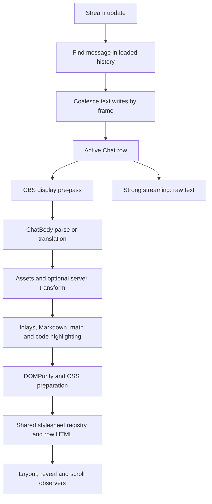

# Rendering Performance Investigation

History: the follow-up fixes and their before-and-after measurements are in [render work budget](../audit/render-work-budget-2026-11-05.md).

Date: 2026-10-25 (Asia/Seoul)  
Repository: `/home/codex/risuai-metatron`  
Inspected revision: `6336e29549c55421f548816f41c6e7abd50ce0cf`  
Scope: chat rendering, streaming ingress, CBS/Markdown/CSS, transforms, translation, row lifecycle, partial editing, highlighting, assets, and screenshot capture. Investigation and documentation only; no application fixes are included.

## Findings at a glance

There are remaining performance problems despite the recent improvements to row isolation, opening/reveal behavior, and stylesheet sharing. The strongest next targets are **history-sized work on every stream update** and **repeated preparation of identical CSS**. Both were reproduced using the actual client modules in Chromium. A third probe found substantial growth in Markdown processing time when a reply contains many fenced code blocks.

The scope of those measurements matters: these are isolated stage measurements, not production input-latency measurements. They establish work that can be removed; they do not establish how often users encounter the stress fixtures.

| ID  | Priority                                  | Finding                                                                                                        | Evidence                                                                                                        |
| --- | ----------------------------------------- | -------------------------------------------------------------------------------------------------------------- | --------------------------------------------------------------------------------------------------------------- |
| F1  | High for long histories                   | Stream ingress searches the entire message array for each update, before frame coalescing                      | Actual store probe: 200 updates took 6.7 ms with 100 messages, 111.8 ms with 2,000, and 833.1 ms with 10,000    |
| F2  | High for CSS-heavy cards                  | Shared stylesheets avoid duplicate live sheets, but each row still evaluates, parses, and scopes identical CSS | Actual sanitizer/style probe: 30 repetitions of a 500-rule sheet took 402.7 ms; 2,000 rules took 1,665.8 ms     |
| F3  | Medium                                    | Non-strong streaming reparses the growing reply; fenced-block replacement adds repeated whole-string scans     | Actual parser probe: 1,600 small JS fences took 138.3 ms versus 13.7 ms for the same code lines in one fence    |
| F4  | Medium                                    | Superseded renders keep doing work; errors can repeat the whole pipeline four times                            | Source-confirmed lifecycle; existing tests prove stale results are hidden, not cancelled                        |
| F5  | Medium when block partial edit is enabled | Hovering the same block clones its subtree and repositions its buttons every frame                             | Actual component probe: 10 mousemove frames caused 10 deep clones and 19 reads of the block rectangle           |
| F6  | Medium, profile further                   | The loaded window is not a hard cap; deferred mounts and global reloads can start a large batch of renders     | Source-confirmed fan-out; production streaming while retaining over 600 rows showed 33.4 ms p95 frame intervals |
| F7  | Medium for long-chat exports              | Screenshot capture retains all row canvases and repeatedly resizes the merged canvas                           | Source-confirmed allocation/lifetime pattern; no large export was attempted                                     |
| F8  | Low                                       | Editor highlight cleanup leaves stale entries in `CSS.highlights`                                              | Actual browser probe: the range remained after changing to plain text and after `removeHighlight`               |

“High” and “Medium” are implementation priorities for the stated workloads, not claims that every chat is currently slow. F8 confirms an existing documented hazard. The media-cache and server-queue observations below are additional conditional risks, not demonstrated leaks or overloads.

## What has already been fixed

The recent history contains several distinct performance changes; the request did not identify one specific incident. These commits establish the baseline inspected here:

| Commit      | Date       | Change that should be preserved                                                |
| ----------- | ---------- | ------------------------------------------------------------------------------ |
| `2ed26dfee` | 2026-10-16 | Per-row streaming updates, distant-row containment, and bottom-append trimming |
| `bfdcfd508` | 2026-10-17 | Mount the opening chat's first screen before the rest of its window            |
| `7a986ac69` | 2026-10-20 | Share one stylesheet per distinct chat CSS/attribute pair                      |
| `52b0c6e52` | 2026-10-25 | End opening reveal within a one-pixel tolerance                                |
| `fd0d71499` | 2026-10-25 | Do not wait for lazy images outside the visible area                           |
| `9489de1df` | 2026-10-25 | Preserve staged mounting when a subsequent diff shows the same rows            |

These are verified commit identities and source changes. Performance numbers in their commit descriptions are historical measurements, not results of this investigation.

Several suspected problems were ruled out or narrowed by reading the current implementation:

- `Chats`' structural effect reads message identity, IDs, and roles, **not every message's text**. Streaming text reaches the active row's disposable effect. Do not restore transcript-wide text dependencies. See [Chats.svelte](../../src/lib/ChatScreens/Chats.svelte), `createRow` and the structural `$effect`, lines 490–570 and 792–817.
- Asset maps, normalized fuzzy indexes, and per-name hit/miss results already exist. Both fuzzy-result caches clear at 10,000 names. Repeated distance-matrix construction for unchanged names is not the current general path. See [parser.svelte.ts](../../src/ts/parser/parser.svelte.ts), `fuzzyIndexOf`/`getClosestMatch`, and [ChatBody.svelte](../../src/lib/ChatScreens/ChatBody.svelte), module-level `imageAssets`.
- A complete server transform cache hit does **not** read or serialize the entire chat. `cachedResults` reads resource revisions and chat metadata; it avoids `loadJobScope`. See [transform.ts](../../server/src/prompt/transform.ts), lines 422–455 and 587–616. The cache is bounded to 512 entries / 16 MiB in [transformCache.ts](../../server/src/prompt/transformCache.ts).
- The stored-message translation path deduplicates in-flight requests by message. The non-LLM pair cache has a four-million-character allowance. These protections should not be conflated with the rendered translation path's lifetime issues in F4. See [storedTranslation.svelte.ts](../../src/ts/translator/storedTranslation.svelte.ts), lines 117–144, and [translator.ts](../../src/ts/translator/translator.ts), lines 35–91.
- Direct asset URLs avoid reading media bytes into page-owned Blob URLs when the controlling worker supports them. Fallback lifetime concerns do not apply equally to this normal direct path.

## Rendering path and cost boundaries



The optional server transform is skipped while a message is locked. All other illustrated client stages still run for ordinary rendered streaming. Strong streaming takes the raw-text path until completion.

The cost scales along independent dimensions:

- **Stored history length:** message lookup and structural scans, even if only 30 rows are mounted.
- **Mounted rows:** global reloads, style preparation, observers, and retained DOM/component state.
- **Active reply length and structure:** repeated CBS/Markdown, highlighting, sanitization, and image scans.
- **Concurrent outstanding work:** translation, transform batches, and obsolete parses.
- **Media/export size:** decoded media, Blob lifetimes, and canvas pixel storage.

`content-visibility` and stylesheet sharing help specific later stages. Neither makes the earlier JavaScript work disappear.

## F1. Stream coalescing happens after a history-sized lookup

**Evidence.** [chatStore.svelte.ts](../../src/ts/storage/chatStore.svelte.ts) `applyServerGeneration`, line 1164, runs:

```ts
const message = heldChat(ref)?.message.find((entry) => entry.chatId === update.messageId);
```

Only later, at lines 1204–1206, does it decide that an update can remain in `heldStreamText` until the scheduled frame. Even updates buffered within the same frame have already traversed the message array. The frame flush's `showStreamText` performs another `.find` at line 1117. For a new reply at the end of an N-message chat and C incoming updates, the ingress lookup alone is O(N × C).

**Reproduction.** A blank Chromium page imported the real store, installed synthetic loaded chats, and called `applyServerGeneration` 200 times synchronously with increasing sequence numbers, always addressing the last message. No `Chat` component was mounted. One 200-call warmup preceded seven measured groups. Calls within each group could not yield to an animation frame, so this specifically measures work that survives coalescing.

| Loaded messages | Median per 200 updates |        Min–max | Approximate median per update |
| --------------: | ---------------------: | -------------: | ----------------------------: |
|             100 |                 6.7 ms |     5.7–8.3 ms |                      0.034 ms |
|           2,000 |               111.8 ms | 111.2–112.4 ms |                      0.559 ms |
|          10,000 |               833.1 ms | 822.9–850.9 ms |                      4.166 ms |

This is a development-module measurement with synthetic back-to-back calls, not 833 ms of observed UI blocking during a real stream. It does demonstrate a history-size dependency before any Markdown or DOM work. Reducing the row window or choosing strong streaming does not remove it.

**Recommended change.** Maintain a message-ID lookup for each held chat, or a validated active-generation lookup, with invalidation on hydration, replacement, deletion, and ID/order changes. Preserve the existing generation/sequence/watermark checks and by-ID addressing; retaining a naked array index across updates would be unsafe. Cover the buffered-update path as well as the immediate write and final flush.

**Acceptance evidence.** A deterministic test should count message visits for updates to the tail of short and long histories, including multiple updates before a frame and a chat replacement between updates. A production trace should then compare equal incoming update rates at 2,000 and 10,000 messages with the same visible window.

**After (2026-11-05).** The [Incremental Chat Transport plan](../plan/incremental-chat-transport.md) D1 landed: by-id lookups in the chat store, `heldMessage` and `activeStreamingIndex` go through `positionOf`, a lazily built per-chat position map that validates each hit by row id and is dropped on structural changes. `src/ts/storage/tests/chatStore.test.ts` ("message positions") counts index builds through `messagePositionStats`. The same F1 evaluate body, before (base code) and after, on one machine (Chrome 156, development modules):

| Loaded messages | Before: median per 200 updates (min–max) | After: median per 200 updates (min–max) |
| --------------: | ---------------------------------------: | --------------------------------------: |
|             100 |                        7.2 ms (6.2–10.1) |                        0.6 ms (0.4–1.9) |
|           2,000 |                   125.8 ms (115.2–147.7) |                        0.6 ms (0.6–0.7) |
|          10,000 |             1,290.9 ms (1,200.3–1,365.6) |                        0.5 ms (0.4–0.7) |

`measureChats.mjs` on the production build (`LONG_MESSAGES=2000` and `10000`, `CHUNKS=200`, `CHUNK_MS=20`; a temporary copy with an 11 s settle after seeding and between boots, because the committed driver trips automatic safe boot, as described below), streaming into Long with about 2,000 rows mounted. At 2,000 messages, before and after match (frame p95 16.8 ms both; one trim long task of 147 vs 118 ms). At 10,000 messages, three runs each: before, frame p95 66.7, 33.4 and 150 ms, long tasks 233, 187 and 1,897 ms in all; after, frame p95 16.8 ms in all three, long tasks 407, 193 and 435 ms (mostly the trim task at send). One whole stream into the 10,000-message chat counted 5 index builds and about 415 lookups. Time to first word dominates the stream's duration and varies between runs, so the frame count is not a duration comparison. The scrolled-up check fails in every run, before and after, from the harness's `scrollTop`-only input (below).

## F2. Stylesheet sharing occurs after repeated CSS preparation

**Evidence.** [parser.svelte.ts](../../src/ts/parser/parser.svelte.ts) `decodeStyleContent`, lines 1269–1285, performs the following for every encoded style restored by a row:

1. Decode the hex body.
2. Run `risuChatParser` over the CSS.
3. Parse a CSS AST.
4. Create a selector parser and rewrite each selector in `decodeStyleRule`.
5. Stringify the scoped CSS.

`trimMarkdownSharingStyles` calls `restoreStyles` before extracting the style and handing it to [ChatStyleRegistry](../../src/ts/parser/chatStyles.ts). The registry deduplicates final styles by value; it cannot eliminate work that already happened independently in each row.

There is a second multiplier in [ChatBody.svelte](../../src/lib/ChatScreens/ChatBody.svelte), lines 407–456: `shownBody` sanitizes/prepares both the pending branch's `lastParsed` and the newly resolved body. A render whose promise stays pending across a paint can prepare the previous content again. The comment at line 336 that trimming is fast is not a reliable assumption for CSS-heavy content.

**Reproduction.** `ParseMarkdown(..., null, "notrim", -1, {}, null)` prepared one input outside the timed section. The probe then called the actual `trimMarkdownSharingStyles` 30 times on that same string. Each sheet contained N rules of the form `.panelN .itemN:hover{color:red;padding:1px 2px}`. Three warmup calls preceded seven measured groups. No DOM insertion, stylesheet registry, layout, or network was included.

| Rules repeated in each row |          Input size | Median for 30 preparations |            Min–max |
| -------------------------: | ------------------: | -------------------------: | -----------------: |
|                          0 |      12 ASCII bytes |                     7.8 ms |        7.5–12.8 ms |
|                        100 |   5,006 ASCII bytes |                    90.1 ms |       83.7–96.2 ms |
|                        500 |  25,806 ASCII bytes |                   402.7 ms |     374.4–424.1 ms |
|                      2,000 | 105,806 ASCII bytes |                 1,665.8 ms | 1,662.0–1,672.1 ms |

Every nonempty fixture produced one extractable style. The measurement is for the combined sanitizer/CBS/CSS preparation stage; it does not separately attribute all time to the CSS parser. Thirty preparations were deliberately run together to expose total work, not to claim that staged mounting always performs them in one task.

**Recommended change.** Introduce a bounded cache for the pure CSS parse/scope/stringify stage keyed by the **post-CBS CSS text**, and investigate retaining an already prepared pending body. Do not cache solely by the raw `<style>` text: CBS variables can change its meaning. Preserve DOMPurify, safe-mode behavior, selector scoping, sanitized attributes, layer/scope handling, and the existing cascade order. Repeated identical content must still share one live stylesheet after the change.

## F3. Full-prefix rendering and fenced-block replacement compound each other

**Evidence.** [Chat.svelte](../../src/lib/ChatScreens/Chat.svelte), lines 670–686, bypasses `displayPrePass` only for strong raw streaming. [ChatBody.svelte](../../src/lib/ChatScreens/ChatBody.svelte), lines 186–190, sends ordinary streaming through `ParseMarkdown`. The settings default is `"off"` in [normalize/ui.ts](../../server/src/data/normalize/ui.ts), line 116.

Within [parser.svelte.ts](../../src/ts/parser/parser.svelte.ts), `renderHighlightableMarkdown` first collects all fenced-block placeholders, then processes each and calls `rendered.replace(placeholder, replacement)` on the growing whole HTML string (lines 220–227 and 397–415). B blocks in output of length M can incur O(B × M) search/copy work in addition to highlighting. KaTeX, Markdown, syntax highlighting, and sanitization are synchronous client work; the CBS deadline does not bound them.

**Reproduction.** Generate N lines `const vN = N;`, either in one JavaScript fence or as N individual fences. Warm the language import and parser with three calls, then measure seven `ParseMarkdown(..., null, "notrim", -1, {}, null)` calls. No final DOMPurify or layout was timed.

| Code lines | One fence: input / median | Separate fences: input / median |
| ---------: | ------------------------: | ------------------------------: |
|        100 |      1,597 chars / 1.2 ms |            3,478 chars / 1.9 ms |
|        400 |      6,997 chars / 3.5 ms |          14,578 chars / 10.0 ms |
|      1,600 |    29,797 chars / 13.7 ms |         60,178 chars / 138.3 ms |

The inputs contain the same code lines but different Markdown overhead; they are not equal-byte fixtures. The source establishes repeated whole-string replacements, and the timing shows a large many-block penalty. It does not isolate the exact fraction due to replacement versus per-block highlighter setup. The 1,600-fence case is a stress fixture, not a typical reply.

During a stream, the parser processes the complete growing prefix at each rendered update. Even a linear parser then does work proportional to the sum of prefix lengths. Frame coalescing limits update frequency, while strong mode avoids most of this work until the final render.

**Recommended change.** Assemble highlighted output once from tokens or recorded spans rather than repeatedly replacing the entire string. Consider a bounded per-fence result cache and an adaptive parse cadence for long replies. Any incremental renderer must retain correctness for incomplete fences, thoughts, CBS, HTML, and changing CSS. Preserve the final fully parsed result in every streaming mode; raw mode is an existing mitigation, not proof that the default path is inexpensive.

## F4. Render generations protect display correctness, but do not stop obsolete work

**Evidence.** `markParsingResult` increments `parseRun` in [ChatBody.svelte](../../src/lib/ChatScreens/ChatBody.svelte), lines 419–423. The `run === parseRun` checks guard spinner/`lastParsed` writes, but the parser, translation awaits, and retry recursion have no cancellation check. The component does not register an unmount cancellation for this work.

The catch at lines 307–334 retries immediately with `tries` values 1, 2, and 3. A consistently thrown error therefore invokes the pipeline four times including the original attempt. This applies to thrown failures; server-transform failures normally return the original text and do not take this retry branch.

The existing [ChatBody.svelte.test.ts](../../src/lib/ChatScreens/ChatBody.svelte.test.ts), “keeps the newest render's body when an older render settles later,” deliberately leaves A and B outstanding together. It verifies that stale A cannot replace B. It does not claim that A's remaining CPU/network work stops.

Related multipliers:

- Rendered auto-translation with `autoTranslateCachedOnly` can parse to derive a cache key, then start another parse after the translated-state transition (lines 199–245).
- [translator.ts](../../src/ts/translator/translator.ts) `translateHTML` has at most ten workers **per invocation**, not a global cap across all rows. The rendered LLM cache checks stored results, without the per-message in-flight map used by the stored-message translation path.
- [transformClient.ts](../../src/ts/parser/transformClient.ts) deduplicates matching targets inside a pending frame batch. Once `batches.clear()` runs, a later render does not join that already dispatched batch. HTTP timeout cancellation is present, but cancellation tied to a row being superseded or unmounted is not.

**Impact.** Rapid edits, re-renders, chat switches, or repeated state invalidations can leave expensive old work running. Duplicate provider requests are a plausible rendered-translation consequence; they were not reproduced against a paid or remote provider in this investigation.

**Recommended change.** Give each render a lifetime signal, check it after awaits and before expensive stages/retries, and propagate it through cancellable operations. Shared requests need subscriber accounting so cancelling one row does not cancel another row's result. Never retry an obsolete run; classify deterministic parser failures separately from transient I/O failures. Keep the stale-display and stale-transform-effect guards even after cancellation is added.

## F5. Partial-edit hover performs avoidable work on an unchanged target

**Evidence.** [PartialEditController.svelte](../../src/lib/ChatScreens/PartialEditController.svelte) has an ineffective early return at line 165:

```ts
if (currentHoveredBlock === block && blockButtonWrapper?.style.display === "block") return;
```

The same function sets the display to `"flex"` at line 191. The pointer handler is already throttled by `requestAnimationFrame`, but on each active frame it calls `hasTextContent`, which deep-clones the hovered block and removes buttons from the clone (lines 107–110, 567–585). Fixing the display comparison alone would not remove that earlier clone.

**Reproduction.** Mount the actual component with block editing enabled and a visible paragraph containing 1,000 `<em>` children. After its real IntersectionObserver activates it, dispatch ten mousemove events at different coordinates inside that same paragraph, one per frame. Wrap that paragraph's `cloneNode` and `getBoundingClientRect` to count calls without changing their behavior.

Result: **10 deep clones, 19 block-rectangle reads, and final button display `"flex"`.** This establishes redundant work; no claim is made that those 19 reads caused 19 forced layouts. `<em>` is deliberate: a `<span>` is itself in `EDITABLE_BLOCK_SELECTORS` and would change which element is counted.

Each near-row controller also attaches its own document-level mousemove listener. The 300 px observer margin limits active rows, but a screen of short rows still fans an event out to several controllers.

**Recommended change.** Correct the display-state guard, detect unchanged targets before cloning, and replace cloning with a text walk that skips button subtrees or an invalidated content check. A shared active-row hover controller could reduce document-listener fan-out. Preserve button-zone transitions, scroll hiding, and editing behavior.

## F6. Staged opening is not continuous scheduling or a hard row cap

**Evidence.** [Chats.svelte](../../src/lib/ChatScreens/Chats.svelte) initially arms three to eight rows according to its height estimate. `armDeferredRows`, lines 95–101, then arms **all** deferred rows together when the first stage settles, the user interacts, or the three-second mount timer expires. There is no ongoing mount-time budget. By contrast, retired-row disposal explicitly has a four-millisecond budget at lines 581–588.

The default window starts at 30 and grows by 15, but 150 is only the bottom-append trim floor. `trimWindow`, lines 712–735, declines to trim when scrolled up, folded, capturing, jumping, or protecting an editor. Reading older history can retain hundreds or thousands of row components. `.far` containment reduces browser rendering work; it leaves those components, observers, and their reactive work alive.

Global reloads multiply this retained state. Every mounted `Chat` subscribes to `ReloadGUIPointer`, and its `ChatBody` key includes that pointer ([Chat.svelte](../../src/lib/ChatScreens/Chat.svelte), lines 691–697 and 1042–1087). A module change or job `updateGUI`/`reloadDisplay` can therefore recreate every mounted body. See [modules.ts](../../src/ts/process/modules.ts), lines 898–907, and [jobChannel.ts](../../src/ts/network/jobChannel.ts), lines 324–330. `Chats` also removes all far-row containment and re-observes rows on root resize, lines 445–451.

**Assessment.** These are confirmed scheduling and retention policies, not newly reproduced hangs. In the production benchmark described below, a bottom send trimmed 600 rows to 150 and had a 16.7 ms p95 frame interval. Sending while scrolled up retained 615 rows and had a 33.4 ms p95 frame interval, with no tasks at least 50 ms long. This is evidence of a slower frame cadence in that scenario, but the changed viewport/containment state and a single sample stream prevent attributing it solely to row count. The precise runtime bottleneck needs a browser trace. Heavy CSS, translation, or image content can also make the second stage or a global reload expensive even when initial reveal is quick.

**Recommended change.** Profile 30/150/600 mounted rich rows, then introduce a cancellable time-budgeted mount/parse queue if the burst is material. Consider a moving retained window with stable height placeholders when reading old history. Narrow reload causes only where display dependencies permit it; module scripts and CSS can legitimately affect many rows. Preserve editor protection, jumps, scroll anchors, greeting order, and screenshot completion semantics.

## F7. Screenshot capture has a large transient memory footprint

**Evidence.** [DefaultChatScreen.svelte](../../src/lib/ChatScreens/DefaultChatScreen.svelte) `screenShot`, lines 834–904:

- Sets `loadPages = Infinity` and waits for every row to render.
- Stores each row's canvas in an array before creating the final canvas.
- Sets the final canvas's width and height inside the dimension-summing loop, once per source canvas (lines 868–875).
- Keeps the source canvas array while drawing and producing a base64 PNG, then creates decoded bytes for download. Calling `canvas.remove()` does not clear the array's reference or explicitly release its pixel backing store.

For scale, 1,000 rows at 900 × 300 **actual canvas pixels** represent 270 million pixels, or approximately 1.01 GiB for one RGBA copy. Source canvases plus the merged canvas can require roughly twice that raw storage, before DOM, images, encoding, and device-scale effects. This is an arithmetic illustration, not a measured browser allocation; browsers can allocate lazily or reject large dimensions earlier.

**Recommended change.** Sum dimensions first and size the output canvas once. Prefer bounded pages/tiles or a selected range for large exports, and release each source backing store after drawing. Prefer Blob-based export over a base64 round trip where the download API permits it. Keep `finally` restoration of the original row window and scroll position. Validate large-export failure handling without forcing an out-of-memory condition.

## F8. Highlight cleanup does not reconcile the browser registry

**Evidence.** [highlight.ts](../../src/ts/gui/highlight.ts), lines 106–132, only sets categories present in `formatedRanges`. It never deletes an absent category from `CSS.highlights`. `removeHighlight(id)` deletes the internal map entry but does not update the browser registry. [TextAreaInput.svelte](../../src/lib/UI/GUI/TextAreaInput.svelte), lines 140–151, calls this on destroy and schedules highlighting after a short delay on changes.

**Reproduction.** Highlight `{{user}}`, replace the text with `plain text` and highlight again, then call `removeHighlight(id)`. Chromium reported `cbsnest1` with one range at all three checkpoints. The test explicitly cleared `CSS.highlights` before and after the probe.

This confirms stale registry state, not unbounded detached-DOM retention. Live DOM ranges can move when their nodes are removed; a heap trace is needed before attributing a retained subtree to this code. The issue is already listed in the rendering guide's Known Hazards.

**Recommended change.** Reconcile the owned highlight categories, deleting empty ones, on updates and removals. Prevent a delayed highlight callback from restoring a destroyed editor's entry. Use deterministic registry-size/range assertions rather than elapsed-time tests.

## Conditional risks and boundaries for future profiling

| Area                         | Current behavior                                                                                                                                                                                                                                                                                                                                                                     | What remains to establish                                                                                                                                                                                                                                         |
| ---------------------------- | ------------------------------------------------------------------------------------------------------------------------------------------------------------------------------------------------------------------------------------------------------------------------------------------------------------------------------------------------------------------------------------ | ----------------------------------------------------------------------------------------------------------------------------------------------------------------------------------------------------------------------------------------------------------------- |
| CBS limits                   | Client parses have 10 million work units and a two-second cooperative deadline per top-level call. Separate rows/styles get separate budgets. Markdown, DOMPurify, CSS parsing, and highlighting are outside that budget. [limits.ts](../../shared/cbs/limits.ts), [parser.svelte.ts](../../src/ts/parser/parser.svelte.ts):1360                                                     | A limit prevents some runaways; it is not a frame budget. Profile aggregate work and responsiveness under rich-card bursts before selecting a scheduler or worker boundary.                                                                                       |
| Transform burst/backpressure | Client starts all split chunks with `Promise.all`; server admits four active plus 32 queued requests. Requests cap at 64 targets / 4 MiB combined source text, with a 30-second lifecycle. [transformClient.ts](../../src/ts/parser/transformClient.ts):345–367, [transform.ts](../../server/src/prompt/transform.ts):41–48, [shared/transform.ts](../../shared/transform.ts):93–102 | A screenshot or broad reload of large rows can create more batches than a small ordinary window. Reproduce queue occupancy/refusals with local scripts before changing concurrency. A full cache hit still waits for a server slot.                               |
| Translation scheduling       | Non-LLM job workers are capped per `translateHTML` call; combined-paragraph display transforms are awaited one by one after translation. [translator.ts](../../src/ts/translator/translator.ts):512–585                                                                                                                                                                              | Measure many simultaneous rows and high-latency local transform stubs. Separate provider latency, per-call fan-out, and sequential transform round trips. Do not remove stored-message deduplication.                                                             |
| Asset/media lifetime         | Parser `fileSrcCache` retains path/URL strings for the page. Fallback `getFileSrc` pins sources; audio/video inlay fallback URLs are never revoked because cached HTML can retain them. [parser.svelte.ts](../../src/ts/parser/parser.svelte.ts):446–455, [globalApi.svelte.ts](../../src/ts/globalApi.svelte.ts):125–158, [inlays.ts](../../src/ts/process/files/inlays.ts):522–551 | Long-session memory growth in fallback mode is plausible and explicitly permitted by the policy. No retained-byte measurement was made here. Test direct and fallback modes separately, including cached translations, before introducing eviction or revocation. |
| Offscreen media              | Asset expansion can emit autoplay/loop audio and video. The row containment code does not explicitly pause them. [parser.svelte.ts](../../src/ts/parser/parser.svelte.ts):681–698                                                                                                                                                                                                    | Measure decoder/network activity with real local media. Browser visibility policy may reduce activity; CSS containment alone is not an application-owned media lifecycle.                                                                                         |
| Stored translation lookup    | `heldMessage` uses `.find` on the history per row. [storedTranslation.svelte.ts](../../src/ts/translator/storedTranslation.svelte.ts):83–85                                                                                                                                                                                                                                          | It can add O(rows × history) work on mount/structural invalidation. It does not read every message's text on each stream update. Include this consumer in any F1 indexing design.                                                                                 |

## Validation and measurement limits

The checkout was initially clean. Measurements used synthetic content and temporary isolated stores; the user's saved chats and provider credentials were not used.

Environment: Linux x86-64 VM reporting AMD Ryzen 9 3900X / 24 logical CPUs; Node `24.21.0`, pnpm `10.34.1`, headless Chromium `153.0.8010.52`, viewport 1280 × 800, no CPU throttling. The installed client uses Svelte `5.57.1`. Build/type/unit work had finished before browser timing probes ran. Browser timing sessions were run sequentially.

The isolated probes imported Vite development modules into a blank same-origin page. Input construction, module loading, and parser/highlighter warmups were outside timed sections. Seven samples are enough to demonstrate the reported mechanisms, not enough for a reliable production p95. No mobile Safari/Firefox run, low-end-device run, full-session heap-retainer analysis, startup network waterfall, or paid-provider translation experiment was performed.

| Check                                   | Result                                                                                                                             |
| --------------------------------------- | ---------------------------------------------------------------------------------------------------------------------------------- |
| `pnpm check`                            | Passed; Svelte reported zero errors and zero warnings, and server TypeScript completed successfully                                |
| `pnpm --silent test:agent`              | Passed: 7,053 tests, 59 skipped, 482 files; 75.9 seconds. This was a fresh execution, after which the wrapper cached the result.   |
| `pnpm build`                            | Passed. The build emitted nine generated-CSS optimization warnings, a chunk-size warning, and ineffective dynamic-import warnings. |
| Store/CSS/fences/highlight/hover probes | The individual results are recorded in F1–F3, F5, and F8; all used real application functions/components.                          |
| Original `measureChats.mjs`             | Failed before switch/stream measurements: a safe-boot modal intercepted the Go Back click. See below.                              |
| Adapted production benchmark            | Passed all 8 checks after the two harness-only adjustments below; no page errors or unexpected outbound requests.                  |
| Full E2E and slow suites                | Not run; this change adds documentation, with targeted browser investigation rather than application changes.                      |

### The existing production benchmark needs settling and realistic scroll input

The original command was:

```bash
MAX_ROWS=600 CHUNKS=200 CHUNK_MS=20 node util/playwright/measureChats.mjs
```

It seeded successfully and reported a 560 ms median to the sidebar plus 13.1 MiB of collected JS heap, then timed out on Go Back. A diagnostic copy read the actual modal: automatic safe boot had turned off plugins/custom CSS/GUI HTML after the consecutive starts did not settle.

This is explained by the harness's two-second delay between boot iterations ([measureChats.mjs](../../util/playwright/measureChats.mjs), lines 299–316), versus `SAFE_BOOT_SETTLE_MS = 10_000` in [safeBoot.ts](../../src/ts/safeBoot.ts), line 18. The boot samples are therefore unsuitable as a normal-mode baseline, and the original run produced **no valid streaming comparison**.

A temporary harness copy adds an eleven-second untimed settling delay after seeding and replaces the two-second post-boot delay with eleven seconds. Dismissing the modal alone would be insufficient: the current page would still be in safe mode.

That copy reached the streaming checks but initially passed only 7 of 8: the scrolled-up scenario trimmed 600 rows to 150. Its `streamReply({ scrolledUp: true })` only sets `scrollTop` (original harness lines 414–419), whereas `Chats` releases its scroll anchor on wheel/touch/pointer/key input, not on every scroll event. The still-active anchor could restore the newest position and make trimming eligible. This was a harness-input mismatch, not sufficient evidence of a user-scroll regression.

The final temporary copy adds actual wheel input just before that scenario's existing scroll-position assignment:

```js
await page.locator(".default-chat-screen").hover({ position: { x: 20, y: 100 } });
await page.mouse.wheel(0, -200);
```

With both adjustments, all **8 of 8 checks passed**. The fixture, production build, provider cadence, and timed operations were otherwise unchanged. No repository harness, safe-boot, or scrolling code was changed. For reproduction, copy the harness with its relative imports resolved against the repository, apply the two delay changes and the wheel input above, and run it with the same `MAX_ROWS=600 CHUNKS=200 CHUNK_MS=20` environment. Run from a shell without inherited `RISU_SAVE_DIR`, `RISU_HOST`, or `RISU_AGENT_DEV_AUTH_BYPASS` overrides so its store remains temporary.

### Production observations from the completed run

The existing fixture has a 2,000-message chat, a small chat, 50 characters, and a local provider emitting 200 short word chunks 20 ms apart. The default streaming display setting is off. These are plain-content scenarios; they do not include F2's large CSS or F3's many fences.

| Scenario                                                                                     | Result                                                                                       |
| -------------------------------------------------------------------------------------------- | -------------------------------------------------------------------------------------------- |
| Reload until sidebar appears, 3 samples                                                      | Median 536 ms; collected JS heap 13.1 MiB                                                    |
| Open the 2,000-message chat with the default row window, 10 measured samples after 3 warmups | Harness task median 18.3 ms; paint median 23.6 ms / p95 60.3 ms                              |
| Open unloaded 20-message chats, 28 different chats                                           | Median 40.2 ms / p95 43.5 ms until the chat screen exists and another frame runs             |
| Stream into the small chat                                                                   | Frame median/p95 16.7 ms; 0 long tasks                                                       |
| Load older history                                                                           | Collected JS heap: 28.1 MiB at 30 rows, 81.5 MiB at 510, 91.1 MiB at 600                     |
| Final six load-more steps toward 600 rows                                                    | Harness task median 75.2 ms / maximum 259.1 ms; paint median 90.2 ms / maximum 256.8 ms      |
| Send at the bottom after loading 600 rows                                                    | Trimmed to 150; collected JS heap 44.2 MiB; frame p95 16.7 ms, maximum 33.4 ms; 0 long tasks |
| Send while scrolled up with 600 rows initially mounted                                       | Retained 615 rows; frame median 33.3 ms / p95 33.4 ms / maximum 50 ms; 0 long tasks          |

The harness's “task” and “paint” measurements wait for a message-channel turn and two animation frames. Opening metrics do not wait for all asynchronous Markdown/transforms/images to settle. Frame p95 values describe the sampled frames of one stream per scenario, not repeated end-to-end trials. Collected JS heap is not total browser, GPU, image-decoder, or canvas memory. The 259 ms load-more maximum warrants tracing, but a six-step sample is too small to call it a stable percentile or identify its cause.

These results support keeping the existing per-row and trimming protections. They also show why smooth streaming in a small plain chat is insufficient coverage for long retained windows, large styles, and complex individual replies.

## Recommended implementation order

1. **Remove avoidable repeated work:** F1 message lookup, F2 post-CBS CSS preparation cache, and F5 unchanged-hover handling. These have concrete reproductions and relatively clear correctness boundaries.
2. **Bound work lifetimes and bursts:** F4 cancellation/retry classification, then F6 mount scheduling and targeted invalidation. Track active, queued, completed, and abandoned work independently of visible rows.
3. **Optimize large-content paths:** F3 token/span-based fenced output and long-stream cadence; F7 paged screenshot export. Preserve rich rendering and export semantics explicitly.
4. **Repair secondary lifetime issues and measurement coverage:** F8 registry cleanup, media fallback retention policy, and the benchmark settling/scroll-input issues.

For follow-up tests, use deterministic visit counts, deferred I/O, fake animation frames, and explicit lifecycle assertions. Keep wall-clock thresholds out of the default test gate. Once a change is implemented, run production browser comparisons with constant fixture sizes, streaming mode, CPU/network conditions, and viewport.

The browser matrix should cover plain prose, repeated CSS, many code fences, math, bilingual/stored/rendered translation, local media, and scripted transforms; use 30/150/600 mounted rows and 2,000/10,000 stored messages as separate axes. Record first-visible and fully-settled times separately, frame gaps/long tasks, parse counts, queued/abandoned work, stylesheet counts, and post-GC memory. Include switching away mid-parse, scrolling up while streaming, global reload, resizing, and screenshot cancellation/failure.

## Reproduction appendix: isolated probes

The following pattern keeps source-level measurements off the real app screen. Run from the repository root after dependencies are installed, with no other Vite/E2E harness using this checkout's optimizer cache. The two ports must be free. It uses the existing temporary-store harness and a blank document; the fixture installation never boots a save loop.

```bash
node --input-type=module <<'NODE'
import { chromium } from 'playwright-core';
import { startStack, chromePath, isolateContext } from './util/playwright/stack.mjs';

const stack = await startStack({ serverPort: 6181, vitePort: 5281 });
let browser;
try {
  browser = await chromium.launch({ executablePath: chromePath, headless: true });
  const context = await browser.newContext({ viewport: { width: 1280, height: 800 } });
  await isolateContext(context);
  const page = await context.newPage();
  await page.route('**/__render_probe', route => route.fulfill({
    contentType: 'text/html',
    body: '<!doctype html><html><body><div id="root"></div></body></html>',
  }));
  await page.goto(stack.baseURL + '/__render_probe');
  console.log(await browser.version());
  await page.evaluate(async () => {
    const { installFlatDatabase } = await import('/src/ts/storage/tests/installFlatDatabase.ts');
    installFlatDatabase({
      characters: [], modules: [], enabledModules: [], personas: [], botPresets: [],
      hideAllImages: false, returnCSSError: true, blockquoteStyling: false,
    });
  });

  // Replace this evaluate body with one of the probes below.
  console.log(await page.evaluate(async () => {
    const parser = await import('/src/ts/parser/parser.svelte.ts');
    return parser.trimMarkdown('<p>Probe ready</p>');
  }));
} finally {
  await browser?.close();
  await stack.stop();
}
NODE
```

### F1 evaluate body

```js
const store = await import("/src/ts/storage/chatStore.svelte.ts");
const results = [];
for (const count of [100, 2000, 10000]) {
  const ref = { chaId: "probe" + count, chatId: "chat" };
  const message = Array.from({ length: count }, (_, i) => ({ chatId: "m" + i, role: "char", data: "x" }));
  store.assembleChats(
    [{ chaId: ref.chaId }],
    [
      {
        characterId: ref.chaId,
        id: ref.chatId,
        revision: "r1",
        data: { id: ref.chatId, name: "Probe", message, note: "", localLore: [] },
      },
    ],
    [],
  );
  let seq = 0;
  const update = () =>
    store.applyServerGeneration(ref, {
      jobId: "J",
      messageId: "m" + (count - 1),
      generationId: "g" + count,
      text: "x" + seq,
      seq: seq++,
    });
  for (let i = 0; i < 200; i++) update();
  const ms = [];
  for (let sample = 0; sample < 7; sample++) {
    const start = performance.now();
    for (let i = 0; i < 200; i++) update();
    ms.push(performance.now() - start);
  }
  ms.sort((a, b) => a - b);
  results.push({ messages: count, chunks: 200, median: ms[3], min: ms[0], max: ms.at(-1) });
  await new Promise((resolve) => requestAnimationFrame(() => requestAnimationFrame(resolve)));
}
return results;
```

### F2 evaluate body

```js
const { ParseMarkdown, trimMarkdownSharingStyles } = await import("/src/ts/parser/parser.svelte.ts");
const results = [];
for (const rules of [0, 100, 500, 2000]) {
  const css = Array.from({ length: rules }, (_, i) => `.panel${i} .item${i}:hover{color:red;padding:1px 2px}`).join(
    "\n",
  );
  const input = (css ? `<style>${css}</style>` : "") + "<p>hello</p>";
  const md = await ParseMarkdown(input, null, "notrim", -1, {}, null);
  for (let i = 0; i < 3; i++) trimMarkdownSharingStyles(md);
  const ms = [];
  for (let sample = 0; sample < 7; sample++) {
    const start = performance.now();
    for (let row = 0; row < 30; row++) trimMarkdownSharingStyles(md);
    ms.push(performance.now() - start);
  }
  ms.sort((a, b) => a - b);
  results.push({ rules, bytes: input.length, rows: 30, median: ms[3], min: ms[0], max: ms.at(-1) });
}
return results;
```

For F3, use `Array.from({ length: count }, (_, i) => \`const v${i} = ${i};\`)`at counts 100/400/1,600. Join those lines inside one`javascript`fence, or wrap each separately and join with two newlines. Time the complete awaited`ParseMarkdown(input, null, 'notrim', -1, {}, null)`, after three warmups, seven times per fixture.

For F8, import `/src/ts/gui/highlight.ts`, clear `CSS.highlights`, set `#root.textContent = '{{user}}'`, call `highlighter(root, getNewHighlightId())`, and inspect `[...CSS.highlights].map(([key, value]) => [key, value.size])`. Repeat after changing to plain text and after removing that same highlight ID. Clear the registry afterward.

For F5, use the same blank-page harness, import `mount`, `unmount`, and `tick` from `/node_modules/.vite/deps/svelte.js` and the actual `PartialEditController.svelte` component. Use the optimized Svelte import so the mount and compiled component share one runtime. Create the paragraph fixture described in F5 with `width:800px;height:100px;margin:100px 0`, mount with `{ messageData: 'hello', chatIndex: 0, bodyRoot: root, blockEditEnabled: true, dragEditEnabled: false }`, await `tick()` and two frames, then count calls on that paragraph while dispatching ten `mousemove` events at `(40 + i, 110)`, awaiting a frame after each. Restore/unmount the fixture when finished.
